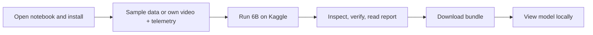

# DRISHTI — Complete beginner's guide to Kaggle

**Purpose:** Take a new user from opening the notebook to running a recorded mission, checking the
result, downloading it, and viewing the model on their own computer.

**Audience:** First-time DRISHTI and Kaggle users. No local GPU or Python installation is needed to
run the reconstruction on Kaggle.

**TL;DR**
- Import [`drishti_colab_full.ipynb`](drishti_colab_full.ipynb) into Kaggle; enable a T4 GPU and Internet.
- Run the setup cells, choose **one** input option, then run **6B** for the aerial sample datasets.
- Run `inspect` and `verify`, read the report, and download the archives before ending the session.
- Use the **full** archive for integrity checking/resume; the **slim** archive is for viewing/sharing.
- Resume keeps the recorded settings. Changing settings requires a fresh run with the current CLI.

**Checked against the notebook and code:** 2026-10-09. This is an operator guide, not a claim that a
fresh full run on the current checkout has passed on Kaggle. See the
[audited build status](../docs/BUILD-STATUS-AND-USAGE.md) for remaining validation.

**Updating after the S1 crash:** commit and push the corrected source **and** notebook, then reimport
the notebook. The default repository is `suryanarayan100406/rtoos_test` on `main`; change it for a fork.
Section 1 prints the fetched commit and stops early if it still contains the known S1 coverage bug.
With the corrected checkout, no manual patch cell is needed. Fresh Kaggle runs now use
`/kaggle/working/drishti`, even if `/content` also exists.

## Contents

1. [What you need and what you will get](#1-what-you-need-and-what-you-will-get)
2. [Create the Kaggle notebook](#2-create-the-kaggle-notebook)
3. [Understand cells, paths, and run order](#3-understand-cells-paths-and-run-order)
4. [Set up the environment: notebook sections 0–4](#4-set-up-the-environment-notebook-sections-04)
5. [Choose inputs: notebook section 5](#5-choose-inputs-notebook-section-5)
6. [Run the reconstruction: notebook section 6](#6-run-the-reconstruction-notebook-section-6)
7. [Check the results: notebook sections 7–8](#7-check-the-results-notebook-sections-78)
8. [Download and preserve results: notebook section 9](#8-download-and-preserve-results-notebook-section-9)
9. [Resume after interruption](#9-resume-after-interruption)
10. [View results on your computer: notebook section 10](#10-view-results-on-your-computer-notebook-section-10)
11. [Troubleshooting](#11-troubleshooting)
12. [Run another mission and share a useful run record](#12-run-another-mission-and-share-a-useful-run-record)

## 1. What you need and what you will get

DRISHTI processes files after a flight. In this workflow, the **whole pipeline runs on the Kaggle
machine**, using its CPU, system memory, and GPU as appropriate. Your laptop runs the browser and later
opens the downloaded results.

### Before you begin

| You need | Details |
|---|---|
| A Kaggle account with GPU access | Complete any account verification Kaggle requests. GPU availability and quotas depend on your account. |
| Internet enabled in the notebook | Used to obtain source code, packages, model checkpoints, and sample imagery. |
| The current notebook and source code | Obtain the notebook from the same project version you will run. Uploading the notebook alone does **not** upload the Python source. |
| A dataset | Choose the included real-sample download, or provide your own recorded video **and** matching GPS/flight telemetry. |
| Space for results | Dense clouds, intermediate files, and archives can be much larger than the source video. Check available disk space in Kaggle and locally. |

Select **GPU T4 ×2** if offered. DRISHTI does not automatically distribute this workflow across both
GPUs; two T4s do not become one 32 GB GPU. The intended aerial setup has roughly 30 GB of **host RAM**
and about 16 GB of GPU memory per T4. Check the actual allocation with `doctor`; these are planning
figures, not a guarantee that every scene fits.

### Results

The run creates a **project bundle**: one folder containing stage outputs, a manifest, logs, and an
HTML/JSON report. Depending on successful exports, it includes a mesh, point cloud, Digital Surface
Model (DSM), Digital Terrain Model (DTM), and orthomosaic (a georeferenced overhead image).

The output list in `s10_export/exports.json` tells you which formats actually succeeded. A missing
optional tool can produce a recorded fallback or skipped export. A completed run is not automatically
a survey-validated result: **≤ 1 m accuracy and < 15 minutes per 10-minute video are design targets**,
not promises for a free T4 session.



## 2. Create the Kaggle notebook

1. Download [`drishti_colab_full.ipynb`](drishti_colab_full.ipynb) from the project. On GitHub, use the
   file's **Download raw file** action; save the `.ipynb`, not the surrounding web page.
2. Sign in at <https://www.kaggle.com/code> and create a **New Notebook**.
3. Use **File → Import Notebook** or the notebook-upload action to import the `.ipynb`. Kaggle menu
   wording may vary.
4. Open **Settings / Session options**:
   - **Accelerator:** GPU T4 ×2, or the available T4 option.
   - **Internet:** On.
5. Give the notebook a recognizable name, for example `drishti-aukerman-first-run`.

Use **`drishti_colab_full.ipynb` even on Kaggle**. Its name reflects its original host; it supports
both hosts. The sibling `drishti_cloud_t4.ipynb` stops early for a split local/cloud workflow and is
not the beginner full-run path.

## 3. Understand cells, paths, and run order

A **code cell** runs when you press its play button or **Shift+Enter**. A **Markdown cell** contains
instructions. Wait for a code cell to finish before moving on. A traceback or nonzero command exit
needs attention even if the notebook lets you run the next cell.

**Do not use Run All on the unedited notebook.** It contains mutually exclusive input choices and
two reconstruction blocks. Run one input cell and one reconstruction block deliberately.

| Location / variable | Meaning |
|---|---|
| `/kaggle/input/…` | Attached datasets. **Read-only.** Input video and telemetry can remain here. |
| `/kaggle/working/…` | Writable session files: code, environments, generated inputs, and output bundles. |
| `REPO_DIR` | The writable source-code folder, normally `/kaggle/working/drishti`. |
| `MISSION` | Path to the YAML **dataset descriptor** that names the video and telemetry files. |
| `RESUME_BUNDLE` | `None` for a new run; a bundle-directory path when continuing an old run. |
| `BUNDLE` | The output folder printed by the run cell and used by inspect/export cells. |
| `PY` | The Python executable selected by the install cell. It may differ from the notebook kernel. |

The run sequence is:

| Notebook section | Action |
|---|---|
| Initial download-permission cell | Run it before the numbered sections. |
| 0–2 | Check GPU, get code, install. |
| 3 | Install Blender if you want the required FBX format included. |
| 4 | Read `doctor` readiness. |
| 5 | Run **D** for sample data, **E** for your own files, or the resume procedure in this guide. |
| 6 | Run **6B** for the aerial samples; skip 6A. |
| 7–8 | Inspect, verify, and read logs/report. |
| 9 | Make and download the archives. |
| 10 | Instructions for your own computer; do not install the local viewer in Kaggle. |

## 4. Set up the environment: notebook sections 0–4

### Initial cell — permit checkpoint downloads

Run the code cell immediately below the notebook introduction. It sets:

```python
import os
os.environ["DRISHTI__models__allow_download"] = "true"
```

The local default is offline. This explicit permission lets the hosted run fetch registered model
checkpoints. The same notebook cell also sets `ON_KAGGLE`, `ON_COLAB`, and `HOST_ROOT`, preferring
`/kaggle/working` over `/content` when both exist. Run the **whole cell**, including host selection,
after restarting the kernel; the excerpt above only shows the checkpoint permission.

### Section 0 — confirm the GPU

Run:

```python
!nvidia-smi
```

You should see a table listing the allocated NVIDIA GPU(s). If it fails or no GPU is listed, fix the
accelerator setting. Later, `doctor` must also detect CUDA through the installed PyTorch environment;
`nvidia-smi` alone checks the driver, not the Python installation.

### Section 1 — get the source code

Choose **one** of these methods.

#### Method A — clone the project repository

Edit the existing section-1 cell:

```python
REPO_URL = "https://github.com/YOUR-OWNER/YOUR-REPOSITORY.git"
REPO_REF = "main"
```

Replace the URL with the real DRISHTI repository containing your latest changes. Use an existing
branch or tag for `REPO_REF`; the initial clone uses `git clone --branch`, so a raw commit hash does
not work as a drop-in branch name. A private repository needs authenticated access, or use Method B.

Run the cell. Check that it prints the checked-out commit and a working directory under
`/kaggle/working`. The repository must contain `pyproject.toml`, `src/`, `configs/`, and `scripts/`.

**When repeating this cell:** it fetches and **hard-resets/cleans** an existing checkout, discarding
local tracked-file edits and untracked non-ignored files. It also resets `MISSION` and
`RESUME_BUNDLE`. For a normal same-session retry, go directly to the resume instructions instead.

#### Method B — attach a source snapshot without GitHub

Use this if your current code is only on your computer.

1. Upload the project source as a Kaggle dataset and attach it with **Add Input**. Include source,
   configs, scripts, `pyproject.toml`, and the project documentation; exclude local virtual
   environments, `node_modules`, generated runs, and model caches.
2. In the input browser, locate the folder **containing `pyproject.toml`** and copy its path. If your
   upload is still a ZIP, use the extraction cell below first and select its printed source path.
3. **Replace/skip the original section-1 clone cell** and run this replacement, editing `SOURCE`:

```python
import os
import shutil
from pathlib import Path

SOURCE = Path("/kaggle/input/YOUR-CODE-DATASET/YOUR-PROJECT-FOLDER")
REPO_DIR = Path("/kaggle/working/drishti-upload")
assert (SOURCE / "pyproject.toml").is_file(), "SOURCE must contain pyproject.toml"
assert not REPO_DIR.exists(), "Choose a new destination or reuse the existing copy deliberately"
shutil.copytree(SOURCE, REPO_DIR)
os.chdir(REPO_DIR)
MISSION = ""
RESUME_BUNDLE = None
print("cwd:", Path.cwd())
```

**If you uploaded a source ZIP:** run this before the replacement cell above, with your ZIP path:

```python
from pathlib import Path
from zipfile import ZipFile

source_zip = Path("/kaggle/input/YOUR-CODE-DATASET/your-project.zip")
unpacked = Path("/kaggle/working/source-unpacked")
assert not unpacked.exists(), "Use a fresh extraction directory"
unpacked.mkdir()
with ZipFile(source_zip) as z:
    z.extractall(unpacked)
print("Choose the project root for SOURCE:")
for project_file in unpacked.rglob("pyproject.toml"):
    print(project_file.parent)
```

Run against this **writable copy**, not directly under `/kaggle/input`. Dataset generation, editable
installation, and output creation need writable paths. Use the printed `REPO_DIR` wherever this guide
shows the default `/kaggle/working/drishti` path.

### Section 2 — install DRISHTI and its dependencies

Run the full install cell and let it finish. It:

1. Checks the kernel's Python version.
2. If Python is newer than 3.12, creates `/kaggle/working/venv312` using `uv` to accommodate the
   Open3D wheel compatibility expected by this notebook.
3. Installs the core CLI and each heavy capability group separately.
4. Installs/checks PyTorch, the neural-model packages, point-cloud export support, and Pillow.
5. Checks CUDA in the selected Python and actually imports modules, printing `OK` or
   `MISSING/BROKEN` with the import error.

Hosted Python versions and package wheels change. The cell's actual output is the source of truth.
An optional install failure can leave the cell running to completion with missing capabilities;
**a finished install cell is not proof that every dependency installed**.

The notebook installs Transformers through the `depth` extra and laspy through `export`.

**UV-textured mesh support is now included:** section 2 installs the `texture` extra for xatlas and
Pillow. You do not need an additional install cell on a successful setup. If that group failed,
address the printed cause and retry it explicitly with:

```python
pipi("-e", ".[texture,export]", required=True)
```

This uses the `pipi` helper from section 2 to install into the correct interpreter. Without xatlas,
S8 can fall back to vertex colors and report why texture baking was unavailable. Installing the extra
makes the atlas path available; inspect `s8_mesh/texture.json` to confirm what actually ran.

For dependency diagnosis in another code cell:

```python
import subprocess
subprocess.run([PY, "-c", "import torch; print(torch.__version__, torch.cuda.is_available())"], check=True)
```

Use `pipi(...)` or `[PY, "-m", "pip", ...]` for extra installations. A notebook-kernel import may
still use a different interpreter from the isolated Python used by `!drishti`.

### Section 3 — install Blender for FBX

Run this cell if you want the full required format set. It attempts to download portable Blender 4.2
and put it on `PATH`. Confirm the printed Blender version is at least 4.0:

```python
!blender --version
```

If it cannot be obtained, the run may continue, but FBX is recorded as skipped and S10 is degraded.
Other formats are independently attempted; check their individual results rather than assuming all
will succeed.

### Section 4 — run the doctor

Run:

```python
!drishti doctor
```

Check three parts of the output:

| Output | What to look for |
|---|---|
| Detected compute | CUDA **yes**, the expected GPU, and the actual host RAM. |
| Stage readiness | Every required stage **ready** for the default path. Fix **blocked** dependencies first. |
| Optional external tools | Missing GLOMAP, PDAL, Blender, or converters may mean a fallback or skipped format. These do not all need to say yes for a baseline run. |

Doctor is a dependency/readiness check. It does not validate your telemetry, download every model,
test every native operation, or certify geometric accuracy. GLOMAP/PDAL/PotreeConverter/py3dtiles are
not all installed by the notebook. In particular, browser 3D Tiles rendering needs a successful
3D Tiles export; see [local viewing](#10-view-results-on-your-computer-notebook-section-10).

## 5. Choose inputs: notebook section 5

### Option D — use a real sample dataset

Edit `DATASET` inside the Option-D cell and run **only that input cell**:

```python
DATASET = "aukerman"
```

| Dataset | Use | Approximate source download |
|---|---|---|
| `brighton_beach` | Smallest listed real sample for checking setup; it is not a building-rich demo. | 62 MB |
| `aukerman` | Real farmstead with house and barn; a useful first building reconstruction. | 543 MB |
| `waterbury` | Larger town survey with more buildings; 248 photos, about 124 seconds of assembled playback. **Current notebook default.** | 1.9 GB |

These are source-size estimates, not output-size or runtime predictions. The script downloads real
geotagged drone **photos**, reads their actual GPS metadata, and assembles MP4 + SRT inputs. Pixels and
positions are real; playback timing is synthesized. It is not a continuous original camera video.
The separate `synthetic` choice is a labelled procedural test scene, not real footage.

Wait for dataset generation to finish without errors. The cell prints `MISSION` and its YAML
descriptor. Confirm the referenced video and telemetry were actually generated; an existing YAML
file alone is not proof that the download succeeded. Read `data/<dataset>/PROVENANCE.txt` for source
details. Proceed to section 6, skipping Options A/B/C/E.

### Option E — use your own video and telemetry

#### Upload the files

1. Choose **Add Input → Upload** (or create a Kaggle dataset and attach it).
2. Upload the drone video and its corresponding GPS/flight log.
3. Expand the input browser and copy the **exact** paths, including filename capitalization.
4. In the Option-E cell, replace its `"upload"` placeholders with those paths. The Colab upload picker
   does not run on Kaggle.

Edit the variables **inside the existing Option-E cell**, not in a separate cell that its defaults
will overwrite:

```python
DATASET_NAME = "my_survey"
VIDEO = "/kaggle/input/my-survey/flight.MP4"
TELEMETRY = "/kaggle/input/my-survey/flight.SRT"
TELE_FORMAT = "dji_srt"

IMU = ""
BARO = ""
INTRINSICS = ""
RTK = ""
CHECK_POINTS = ""

CRS_MODE = "derive_from_gps"
CRS_EPSG = None
TARGET_FPS = 4.0
MAX_FRAMES = 0
TIME_OFFSET_S = 0.0
USE_UPLOAD_WIDGET = False
```

Use a simple `DATASET_NAME` containing letters, numbers, and underscores. Leave absent optional
files as `""`. A video without matching GPS/flight metadata does not satisfy the input contract.

#### Choose the telemetry format

| `TELE_FORMAT` | Input and requirements |
|---|---|
| `dji_srt` | DJI SRT sidecar containing usable latitude, longitude, and altitude fields. Ordinary caption subtitles are insufficient. |
| `csv` | CSV track with a header row and a `CSV_MAP` matching your columns. |
| `mavlink` | A log readable by pymavlink with the supported position messages. A `.bin` extension alone does not guarantee the needed messages are present. |
| `exif` | A file with extractable GPS metadata, using the external `exiftool` executable. The notebook does not install this executable. Option E accepts file paths, not a folder of photographs. |

For CSV with columns named `time_s,lat_deg,lon_deg,alt_m`, edit:

```python
TELE_FORMAT = "csv"
CSV_MAP = {
    "time": "time_s", "lat": "lat_deg", "lon": "lon_deg", "alt": "alt_m",
    "yaw": None, "pitch": None, "roll": None,
}
```

Supply actual latitude/longitude in decimal degrees and altitude in metres; do not put projected
eastings/northings in latitude/longitude columns or use zero as a made-up altitude. CSV time accepts
seconds or ISO-8601 timestamps and is rebased to the first record. Keep altitude references consistent
between telemetry and check-points.

`TIME_OFFSET_S` means **sample telemetry at video time + this offset**. For example, if the recording
starts 5 seconds after the first telemetry record, use `5.0`. Check the resulting alignment in
`s0_ingest/frames.json`; descriptor validation only checks structure, not synchronization accuracy.

#### Optional files and accuracy

- **IMU** means Inertial Measurement Unit; **RTK/PPK** means real-time/post-processed kinematic GNSS
  positioning. Their paths can be registered, but uploading sidecars alone does not establish that
  full sensor fusion executed. Several IMU/RTK/barometer integrations remain incomplete; read the
  actual stage metrics and [gap report](../docs/TECHNICAL-GAP-REPORT.md).
- Camera intrinsics can be supplied; otherwise the baseline uses camera self-calibration.
- `CRS_MODE = "derive_from_gps"` derives the Coordinate Reference System (CRS), using the GPS track's
  Universal Transverse Mercator (UTM) zone. Only set an explicit EPSG identifier if you know the
  required CRS; do not copy another mission's zone.
- Set `CHECK_POINTS` to independent surveyed points if you have them. CSV accepts `lat,lon,alt`
  columns (also `latitude,longitude,altitude`); GeoJSON uses Point features with `[lon, lat, height]`
  coordinates or an altitude property. Heights are metres in a compatible vertical reference.
- The current check-point report measures **DSM elevation error** at those locations. It does not
  independently validate full horizontal/3D accuracy. Without usable check-points, accuracy remains
  **UNVALIDATED**.

`TARGET_FPS` is frames sampled per second; `MAX_FRAMES = 0` means no cap. A positive cap processes only
part of the clip and may remove necessary coverage. Keep defaults for an initial complete mission.

#### Run Option E and confirm it worked

Run the entire edited cell. Expect a validated descriptor and a printed `MISSION` such as:

```text
/kaggle/working/drishti/data/my_survey/my_survey.yaml
```

The original input files remain in place; the generated descriptor lives under the writable source
folder. No repository commit is needed for mission files. If validation was skipped or failed, resolve
the printed error before starting reconstruction. Skip the other input cells.

### Already have a descriptor, or want to resume?

- For an existing YAML descriptor on Kaggle, skip the Colab-specific A/B upload code. In a new cell
  set `MISSION = "/kaggle/input/your-dataset/mission.yaml"` and `RESUME_BUNDLE = None`. Use absolute
  paths for its media; relative paths resolve from the process working directory, not the YAML's
  parent directory.
- Built-in **Option C** supports both hosts. Set `RUN_OPTION_C = True` and `BUNDLE_SOURCE` to a
  writable bundle directory or a full ZIP. Set `INPUT_ROOT` if the recorded relative source files
  live outside `REPO_DIR`. Colab also offers an upload picker when no path is supplied; Kaggle needs
  an explicit path. See [restore/resume below](#9-resume-after-interruption).

## 6. Run the reconstruction: notebook section 6

### Include a convenient GLB deliverable

The current default requests glTF but does **not** explicitly request GLB. To request both, add and
run this cell **before a fresh 6B run**:

```python
import os
os.environ["DRISHTI__export__formats"] = "[obj, ply, las, geotiff, gltf, glb, fbx]"
```

This is useful for opening a self-contained model in Blender. It keeps the other required formats.
The resolved list is recorded in the bundle. It does not change an already-created bundle on resume.

### Choose 6B for the aerial datasets

Run **Block 6B only**. It is self-contained; you do not need to run 6A first.

| Setting in 6B | Meaning |
|---|---|
| `--profile balanced` | Depth Anything V2 Small, tiled Truncated Signed Distance Function (TSDF) fusion, and Poisson meshing. |
| `poses.matcher=exhaustive` | All-pairs feature matching, useful for cross-strip connections in the survey samples. |
| `dense.depth_trunc_m=150` | Discard depth beyond 150 m. This must reach the visible surface from the camera. |
| `dense.tsdf_voxel_m=0.05` | A 5 cm dense-fusion voxel, inherited from balanced. **Not a 5 cm accuracy claim.** |

6A uses a 40 m depth limit for close/low-altitude footage. It can discard the ground from flights
around 100–130 m **Above Ground Level (AGL)**. For your own survey, select a limit that exceeds the
actual camera-to-surface range, including oblique viewing distance; 150 m is a sample-specific starting
point, not universal. Edit the fresh-run command in 6B if needed.

The cell launches the equivalent of this command, substituting the actual paths and timestamp:

```bash
drishti run --dataset "PATH_TO_MISSION.yaml" --profile balanced --run-id YOUR_NEW_RUN_ID \
  --set poses.matcher=exhaustive \
  --set dense.depth_trunc_m=150
```

**You normally just run the existing 6B cell**, which also captures logs and sets `BUNDLE`. In a new
run, `RESUME_BUNDLE` must be `None`.

### What happens while it runs

```text
s0_ingest → s1_frameqa → s2_poses → s6_global → s3_masking → s4_depth
→ s7_dense → s8_mesh → s9_geo → s10_export → report
```

| Stage | What it does |
|---|---|
| S0 / S1 | Decode video, align telemetry, assess frames, select keyframes. |
| S2 / S6 | Estimate and georeference camera poses; produce globally consistent views. |
| S3 / S4 | Mask dynamic objects and estimate metric-aligned depth. |
| S7 / S8 | Fuse depth into a dense cloud; build and color/texture the mesh. |
| S9 / S10 | Produce geospatial rasters and requested exports. |
| Report | Summarize measured timings, evidence, degradation, and available accuracy checks. |

The console prints stage starts/completions and the final exit status. CPU-only operations can leave
the GPU idle; that is expected during TSDF fusion, Poisson meshing, raster work, or export. Duration
depends on the scene, frame count, downloads, and allocated hardware. Read measured times afterward.

At the end, record the printed path:

```text
[exit 0]  bundle: /kaggle/working/drishti/runs/colab-full-<timestamp>
```

`colab-full-…` is the notebook's run-name prefix even on Kaggle. A nonzero exit means you should
inspect the error and use [troubleshooting](#11-troubleshooting). An exit of zero can include degraded
stages or skipped exports; check the report.

## 7. Check the results: notebook sections 7–8

### Section 7 — inspect and verify

Run the existing cell:

```python
!drishti inspect "$BUNDLE"
!drishti verify "$BUNDLE"
```

- **Inspect** reads the manifest: statuses, timing, confidence, and error/degradation notes.
- **Verify** checks recorded output hashes against files. It checks integrity, not geometric accuracy.
- `done` means the stage completed; `degraded` means it completed with a recorded limitation;
  `failed` means it stopped with an error. Missing stages mean the run did not reach them.
- After a forced process kill, a stage can remain marked `running` because it could not write its
  final status. Check whether the process is still alive before trying to resume.

Confidence values are stage-specific signals and policy-capped estimates, not probabilities of
meeting the 1 m target. Read evidence and check-point results alongside them.

### Section 8 — logs and report

Run the cell to print available logs and the report summary. Useful files are:

| Bundle-relative file | Use |
|---|---|
| `manifest.json` | Recorded settings, dataset paths, stage metrics, output hashes. |
| `logs/run_console.log` | Console captured by the run cell. |
| `report/report.html` | Readable report; open it locally after downloading. |
| `report/report.json` | Machine-readable timing, status, and accuracy summary. |
| `s7_dense/tile_states.json` | Adaptive TSDF tile support, reconstructed/unknown regions, and reasons. |
| `s8_mesh/texture.json` | Actual texture method or fallback. |
| `s9_geo/geo.json` | Raster metadata, coverage, and the DTM method actually used. |
| `s10_export/exports.json` | Each requested format's success, path, or failure reason. |

To inspect the export list in a new cell:

```python
import json
from pathlib import Path

export_file = Path(BUNDLE) / "s10_export" / "exports.json"
if export_file.is_file():
    exports = json.loads(export_file.read_text())
    for fmt, result in exports["results"].items():
        print(fmt, "OK" if result["ok"] else "SKIPPED/FAILED", result["path"] or result["reason"])
else:
    print("S10 has not produced an export list; inspect the failed/last-running stage.")
```

Before treating the run as usable, check model coverage visually, review unknown tiles, read degraded
reasons, and confirm the formats you need actually exist. Reconstruction scale/georeference and
checkpoint accuracy are separate from file integrity.

During S7, `tile_states.json` is atomically updated after each tile/slab progress event. If adaptive
metric-footprint fusion completes with no points, the runner logs a warning and retries the same metric
inputs with the legacy camera-center tiler; the file records both attempts and the final backend. If the
retry also fails, download the **full** archive before closing the session so the saved evidence can be
classified. A successful fallback is marked as degraded in the manifest; it is still real TSDF fusion,
not a placeholder cloud.

## 8. Download and preserve results: notebook section 9

Run the export/archive cell. It creates **both** ZIPs beside the bundle, normally:

```text
/kaggle/working/drishti/runs/<run_id>_full.zip
/kaggle/working/drishti/runs/<run_id>_slim.zip
```

Use the exact paths printed by the cell; archives are under `drishti/runs`, not necessarily directly
under `/kaggle/working`. Refresh the Kaggle file/output browser, navigate to them, and download.

If you resumed a legacy bundle still under `/content`, its ZIPs are created there too. After section 9,
copy those ZIPs into Kaggle's output area to expose them in its file browser:

```python
# Only needed for a legacy /content bundle resumed on Kaggle.
if ON_KAGGLE:
    for archive_path in (full_zip, slim_zip):
        source = Path(archive_path)
        if HOST_ROOT not in source.resolve().parents:
            shutil.copy2(source, HOST_ROOT / source.name)
```

| Archive | Includes | Use |
|---|---|---|
| **Full** | The whole run directory: manifest, all existing stage artifacts, logs, and report. | Integrity verification, inspecting intermediates, continuing a partial run. |
| **Slim** | `manifest.json`, `report/`, `logs/`, `s10_export/`. | Sharing and opening exported models/rasters. |

**The full bundle is not a complete copy of the source environment.** Original video/telemetry are
normally referenced rather than copied; model caches and the source checkout sit outside the bundle.
Keep the original mission files, generated descriptor, and source version separately for future resume
or reproduction.

**Do not expect whole-bundle `verify` to pass on a slim archive:** it intentionally omits artifacts
still referenced by its manifest. Use the full archive for that check. Slim is also not a resume
package.

Archiving requires extra disk space and time. If it fails with “No space left on device,” retain the
bundle and recover needed files first. You can create only the slim archive by skipping the `full
bundle` block in the export cell; it is independent on Kaggle. Do not delete intermediate artifacts
from a bundle you still want to verify or resume.

### Keep the outputs after the session ends

Download important results before ending the session; a live `/kaggle/working` directory is not a
permanent backup. If using Kaggle's **Save Version** workflow, confirm the saved version's **Output**
tab actually contains the ZIPs before relying on it.

Some save modes execute the notebook again from a clean session. Before using **Save & Run All**,
make a copy of your notebook that keeps only your chosen source setup, chosen input option, and
6B block. Remove unused A/B/C/D/E options and 6A from that copy, supply explicit Kaggle paths, and
ensure it needs no interactive uploads. Otherwise the notebook can launch unwanted duplicate runs or
overwrite your input selection.

## 9. Resume after interruption

### Same session, same settings

First resolve the error, for example a failed dependency install, and keep all original inputs
available. The updated 6A/6B cells **append timestamped attempts** to `run_console.log`; previous
attempts are retained. This backup step is still useful with older notebooks that overwrite the log:

```python
import shutil
import time
from pathlib import Path

B = Path(BUNDLE)
log = B / "logs" / "run_console.log"
if log.is_file():
    shutil.copy2(log, log.with_name(f"run_console_before_resume_{time.time_ns()}.log"))
RESUME_BUNDLE = str(B)
```

Then rerun **6B**. It runs `drishti resume` and skips completed stages whose recorded input/settings
hashes match. It restarts the interrupted stage; it does not promise to continue halfway through a
tile or native operation. Keep completed artifacts intact—freshness checking is not a substitute
for `verify` on a moved or edited bundle.

**Settings are frozen on resume.** The current CLI accepts `--only`, `--upto`, and `--force` for
resume, but **no `--set`, `--profile`, or `--dataset`**. Changing environment variables, the original
YAML, or the fresh-run branch of 6B does not change a resumed bundle's configuration. In particular,
resuming a 6A bundle in 6B retains the old 40 m depth limit. To use different settings, set
`RESUME_BUNDLE = None` and start a new run.

### New Kaggle session or restored bundle

1. Restore source/setup using the same project version; run the initial permission cell and sections
   0–4 again. Environments and notebook variables may have disappeared.
2. Attach your **full** bundle archive and original mission files as Kaggle inputs.
3. Use built-in Option C: set `RUN_OPTION_C = True`, `BUNDLE_SOURCE` to the full ZIP path, and
   `INPUT_ROOT` to the directory containing the recorded relative inputs (blank means `REPO_DIR`).
   It extracts the archive into a unique writable `drishti-restored-…` directory, checks for one
   manifest and the original video/telemetry, and sets `BUNDLE`/`RESUME_BUNDLE`. Run 6B afterward.
   **Alternatively**, perform the restore manually with the following cells, editing the ZIP path:

```python
from pathlib import Path
from zipfile import ZipFile

archive = Path("/kaggle/input/YOUR-SAVED-RUN/YOUR-RUN_full.zip")
restore_root = Path("/kaggle/working/restored-runs")
restore_root.mkdir(exist_ok=True)
with ZipFile(archive) as z:
    z.extractall(restore_root)
print("Candidate bundles:")
for manifest in restore_root.rglob("manifest.json"):
    print(manifest.parent)
```

4. Select the exact directory containing the desired `manifest.json`:

```python
import json
from pathlib import Path

RESUME_BUNDLE = "/kaggle/working/restored-runs/YOUR-RUN"
BUNDLE = RESUME_BUNDLE
MISSION = ""
saved = json.loads((Path(BUNDLE) / "manifest.json").read_text())
print("Recorded inputs:", saved.get("dataset_snapshot"))
```

5. Restore the source video/telemetry at the **recorded paths** before resuming. S0 rechecks them.
   Reattach the same Kaggle dataset paths for Option E; for relative paths such as
   `data/aukerman/…`, restore them under `REPO_DIR` and run from there. Byte-identical originals give
   the best chance of reusing completed stages; regenerated files can have different hashes.
6. Verify the completed outputs, back up the prior console log as above, then rerun 6B.

For a moved bundle, a missing original input can trigger S0 recomputation and failure even when its
decoded frames are present. If recorded paths cannot be restored, prepare a new mission descriptor
and start a fresh run rather than assuming that changing `MISSION` alters the saved snapshot.

### Retry an optional export after installing its tool

Completed degraded stages are cached too. If you install Blender after a run, plain `resume` may
skip S10. To regenerate exports **with the same requested format list**, and refresh the report:

```python
!drishti resume "$BUNDLE" --only s10_export --force
!drishti resume "$BUNDLE" --only report --force
!drishti verify "$BUNDLE"
```

Check each command succeeded. Recreate/download the archives afterward. This retries recorded
settings; it does not add a new format to an old bundle.

## 10. View results on your computer: notebook section 10

### Simplest route — open exported files

1. Extract the downloaded ZIP using your operating system's archive tool.
2. Open `<run_id>/report/report.html` in a browser.
3. Read `<run_id>/s10_export/exports.json` to locate successful files.

| File, when successfully produced | Open with |
|---|---|
| `s10_export/model.glb` or `model.gltf` | Blender: **File → Import → glTF 2.0**. GLB needs the explicit request above. Keep glTF companion files together. |
| `s10_export/model.obj` / `model.ply` / `model.fbx` | Blender or a compatible mesh viewer; select the object and use **Frame Selected** if it appears off-screen. |
| `s10_export/points.las` / `points.laz` | CloudCompare or a point-cloud-capable GIS application. Accept a display/global shift for large coordinates while preserving the original georeference. |
| `s10_export/geotiff/dsm.tif`, `dtm.tif`, `ortho.tif` | QGIS: drag the files onto the map. GeoTIFF rasters are not ordinary browser-preview images. |
| `s7_dense/dense.ply` | Dense point cloud in the full TSDF bundle; use CloudCompare. `model.ply` is the exported mesh, not this dense cloud. |

GLB/glTF assets can use a local translated origin to preserve floating-point precision; keep their
`.georef.json` sidecars with them. A display coordinate near zero is not the mission's geographic
coordinate. Keep the complete export directory when sharing models.

The standard pipeline does **not** create the custom `viewer.html`, `view_model.cmd`, or `index.html`
shown in some historical run notes. Use the desktop applications above or the maintained viewer below.

### DRISHTI web viewer — local setup

Install Python 3.11/3.12 and a current Node.js LTS with npm, and obtain the same DRISHTI source
checkout on your computer. No CUDA or reconstruction libraries are required just to serve results.

Extract the full ZIP under the repository's `runs` folder so the layout is exactly:

```text
YOUR-PROJECT/
├── pyproject.toml
├── server/
├── viewer/
└── runs/
    └── YOUR-RUN/
        ├── manifest.json
        ├── report/
        └── s10_export/
```

Avoid an extra nested archive folder: the server looks for `runs/<run_id>/manifest.json`.

**Windows PowerShell — terminal 1, opened at the repository root:**

```powershell
py -3.12 -m venv .venv
.\.venv\Scripts\python.exe -m pip install -e ".[server]"
.\.venv\Scripts\drishti.exe inspect "runs/YOUR-RUN"
.\.venv\Scripts\drishti.exe verify "runs/YOUR-RUN"
.\.venv\Scripts\python.exe -m server.app
```

**Linux/macOS — terminal 1, opened at the repository root:**

```bash
python3 -m venv .venv
.venv/bin/python -m pip install -e ".[server]"
.venv/bin/drishti inspect "runs/YOUR-RUN"
.venv/bin/drishti verify "runs/YOUR-RUN"
.venv/bin/python -m server.app
```

Substitute your actual run-folder name. Keep the server terminal open. Visit
<http://localhost:8000/api/health>; it should return JSON with `status: "ok"`.

**Terminal 2 — start at the repository root, on either platform:**

```bash
cd viewer
npm ci
npm run dev
```

Open the URL printed by Vite, normally <http://localhost:5173>. Select your run and use the mission,
run details, confidence, accuracy, and exports tabs. Stop the servers later with **Ctrl+C**.

The **Digital twin** tab renders only a successful **3D Tiles** export. It does not automatically
load a GLB/PLY in place of one. If `exports.json` reports 3D Tiles skipped or failed, use the desktop
mesh viewer while still using DRISHTI's UI for the report and status. The notebook does not install
the `py3dtiles` converter by default; availability alone would not prove conversion succeeded.
Potree is offered as an export/download when available; embedded Potree rendering is not implemented.

A local `doctor` showing missing reconstruction dependencies is expected on this view-only setup.
Use `inspect`/`verify` for an already finished run; `resume` is not a viewing command and can need the
original inputs and heavy libraries.

## 11. Troubleshooting

| Symptom | What to do |
|---|---|
| `REPO_URL` still contains a placeholder, or clone fails | Enter the real repository URL and existing branch/tag; check Internet/access. Use the source-snapshot method if needed. |
| `Read-only file system` | Code/output must be under `/kaggle/working`; only input files should remain under `/kaggle/input`. |
| `REPO_DIR`, `PY`, `MISSION`, or `BUNDLE` is undefined | Run the corresponding setup/input/run cell. After a kernel restart, recreate setup variables and restore the correct bundle path. |
| `drishti: command not found` | Section 2 did not finish its core install, or the isolated environment's `PATH` was lost. Re-run setup/install and check `!drishti --version`. |
| Open3D has no compatible wheel | Confirm section 2 selected Python 3.12 when the kernel is newer; read the `uv` installation error before continuing. |
| `doctor` shows a blocked stage | Install the named dependency in the target `PY` environment, then run doctor again. |
| `nvidia-smi` works but `torch.cuda.is_available()` is false | Check the PyTorch build in `PY`, not just the kernel; follow the install error and driver compatibility. |
| Checkpoint download/offline-cache error | Run the initial `allow_download` cell, enable Internet, and check the actual model URL/cache error. |
| Option E asks for an uploader on Kaggle | Replace `"upload"` with real `/kaggle/input/...` file paths. |
| CSV/SRT cannot be parsed, or no GPS records | Confirm the format and column names and that the log contains real positions/altitudes. Plain subtitles are not GPS telemetry. |
| S1 fails with `zip() argument 2 is shorter than argument 1` | An older S1 source snapshot has a mismatched adjacent-frame pair calculation. Apply the targeted fix below, then resume the existing bundle. |
| Too few keyframes or unregistered views | Review sharpness, exposure, overlap, telemetry alignment, and S1/S2 logs. A larger GPU cannot recover missing visual overlap. |
| `[exit -9]` or `137` | The process was killed; host-RAM exhaustion is a common cause but not the only one. Identify the last stage and inspect resource usage. See below. |
| `CUDA out of memory` | GPU memory exhaustion differs from host RAM. Identify the neural stage, free competing GPU processes, and use appropriate fresh-run model/resolution settings. |
| Fragmented model or missing ground | Check the actual saved matching/depth settings, pose fit, and tile/depth coverage. Ensure the depth limit reaches the ground; inspect the reconstructed data as well as the renderer. |
| `No such option: --set` on resume | Resume does not accept overrides. Start a fresh run for changed settings. |
| Missing `model.glb` | Check `exports.json`. GLB must be explicitly requested before a fresh run; glTF alone is the current default. |
| Missing FBX / 3D Tiles / Potree | Read that format's recorded reason; optional tools or conversion may be unavailable. Other formats are checked independently. |
| Missing `report.html` | The pipeline probably stopped before `report`; inspect the manifest and console. You can still archive a partial bundle. |
| `s7_dense: TSDF produced an empty cloud` | Use the current source: adaptive S7 now retries the legacy camera-center tiler and writes incremental `s7_dense/tile_states.json`. Inspect the saved extracted/emitted counts; download the full archive before closing the session if both backends fail. |
| `verify` reports missing files | Use the full archive, not slim. On a full bundle, check extraction/download completeness before trusting it. |
| Viewer lists no runs | Check the directory nesting and `/api/health`'s `runs_dir`; start the API at the repository root. |
| Viewer shows status but no 3D model | Check the `3dtiles` export result. Open a successful GLB/OBJ/PLY in a desktop viewer. |

### S1 adjacent-frame coverage error in an older checkout

A Waterbury hosted run on 2026-10-09 reached S1 and failed while summing the accepted frames' GPS
track length. The old expression paired all `n` frames with the last `n-1` frames using strict zip,
which always raises for nonempty input. The corrected expression pairs `accepted[:-1]` with
`accepted[1:]`, both of length `n-1`. This is a code fix; changing QA thresholds will not fix it.

The current source already contains the correction. After committing/pushing it and reimporting the
updated notebook, run the normal setup; the patch below is only for an older, still-running checkout.

If your running session has that exact traceback in `s1_frameqa.py`, apply this cell without
re-cloning, reinstalling, or downloading the dataset again:

```python
import shutil
from pathlib import Path

source_file = Path(REPO_DIR) / "src/drishti/stages/s1_frameqa.py"
old = "zip(accepted, accepted[1:], strict=True)"
new = "zip(accepted[:-1], accepted[1:], strict=True)"
source = source_file.read_text(encoding="utf-8")
if old in source:
    assert source.count(old) == 1, "Unexpected source; inspect before patching"
    patched = source.replace(old, new)
    compile(patched, str(source_file), "exec")
    shutil.copy2(source_file, source_file.with_suffix(".py.before_s1_fix"))
    source_file.write_text(patched, encoding="utf-8")
    print("Fixed S1 adjacent-frame coverage:", source_file)
elif new in source:
    print("S1 fix is already present:", source_file)
else:
    raise RuntimeError("Source differs from this patch; inspect the actual traceback/source")
```

Then follow [same-session resume](#same-session-same-settings): preserve the previous console log,
set `RESUME_BUNDLE = BUNDLE`, and rerun **6B**. The editable installation uses the patched source in
the newly launched process. With the original inputs unchanged, S0 is skipped and S1 restarts.
The clone/reset cell would discard this local patch; carry the correction into the source repository
used for future sessions as well.

### Memory failures: identify the stage before changing settings

Open3D TSDF and Poisson paths use **host RAM**, not the idle second T4. S7 is tiled and S9/S10 stream
large point products, but this does not guarantee that every scene or export fits. Read the last
stage/tile line and Kaggle's memory display.

The default `dense.tile.tile_m` is already **40 m**. Repeating `40` is not a smaller-tile fix. If S7 is
the bottleneck, an example to try in the **fresh-run command** is:

```text
--set dense.tile.tile_m=20
```

This changes partition size, not the 5 cm voxel, and can increase runtime. It is a tuning example,
not a measured guarantee. It cannot fix an S8/S9/S10 memory failure. Keep the depth limit appropriate
to the camera-to-ground distance rather than deleting far-away ground to reduce memory.

To apply any new setting, edit the fresh-run command, set `RESUME_BUNDLE = None`, and run 6B again
with a new run ID. To retry unchanged settings on a larger-memory session, restore and resume the
full bundle instead.

## 12. Run another mission and share a useful run record

For a different dataset in the same session:

1. Preserve/download the previous bundle.
2. Run the chosen input cell with new files or a new dataset name.
   If Option C selected a different input working directory, first run `os.chdir(REPO_DIR)` before
   generating a new sample with Option D.
3. Ensure `RESUME_BUNDLE = None` and `MISSION` points at the new descriptor.
4. Review environment overrides before starting 6B. Option E's ingest overrides remain in the
   kernel session and can affect a later Option D run. To restore ingest defaults:

```python
import os
for key in ("target_fps", "max_frames", "time_offset_s"):
    os.environ.pop(f"DRISHTI__ingest__{key}", None)
```

5. Run 6B, then inspect, verify, and archive the new bundle.

When sharing a result or requesting debugging help, include the source version/section-1 commit,
dataset name, `doctor` output, run ID, last failing stage, console error, and `manifest.json`.
Include `report.json`, `exports.json`, and tile evidence if they exist. Report measured stage times
and resource readings; do not substitute target figures or infer accuracy from visual appearance.

## Open questions / risks

- The current native/cloud pipeline still needs a fresh real-footage end-to-end validation run;
  local tests and a valid notebook do not establish aerial accuracy or a memory/time ceiling.
- Kaggle resources, quotas, menus, Python versions, and available wheels can change. Read the live
  setup output and preserve results before the session ends.
- Low-overlap, occluded, or weakly observed surfaces can remain unknown. Reconstructed/inferred
  geometry is not measurement-authoritative just because it looks complete.

## Further reading

- [Notebook reference](README.md) — full hosted versus tier-split notebooks.
- [Code-accurate usage and internals](../docs/GUIDE.md).
- [Audited build status and usage](../docs/BUILD-STATUS-AND-USAGE.md).
- [Detailed input/run reference](../docs/RUN_GUIDE.md).
- [Viewer reference](../viewer/README.md).
- [Canonical architecture](../docs/_internal/CANONICAL-ARCHITECTURE-SPEC.md) and the
  [sanctioned offline scope](../AGENTS.md#2-scope-what-changed-and-why-it-matters).
